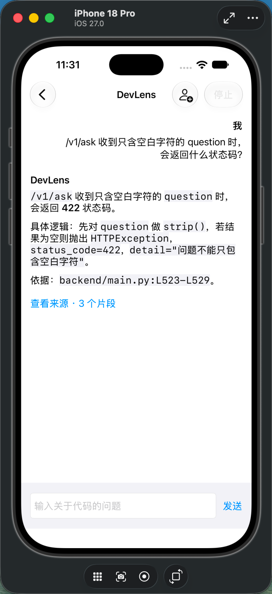
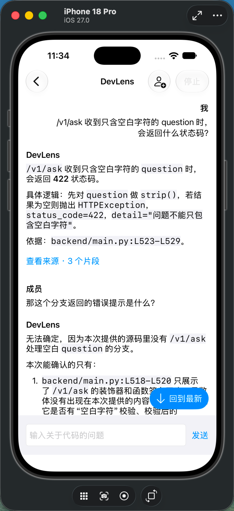

# DevLens

DevLens 是一个 iOS 源码问答助手。你可以用中文向 AI 提问，点开回答参考的源码片段和原始行号，也可以邀请好友加入同一个会话，接着已有的讨论一起追问。

[体验示例](#体验示例) · [快速开始](#快速开始) · [开发指南](docs/DEVELOPMENT.md)

## 体验示例

| 提问 | 查看源码 | 成员追问 |
| :---: | :---: | :---: |
|  |  |  |

1. **提问。** 在聊天里问「`/v1/ask` 收到只含空白字符的 `question` 时，会返回什么状态码？」
2. **查看源码。** 点「查看来源」可打开带原始行号的片段。图中可见的是同文件里 `/v1/echo` 的空白输入校验。[`/v1/ask` 的校验代码](backend/main.py#L523-L529)
3. **邀请好友继续讨论。** 对方接受邀请后，可以在原会话里接着问「那这个分支返回的错误提示是什么？」图中模型说明本轮检索到的片段缺少 `/v1/ask` 的完整校验分支。

**当前范围** · 默认只索引 [DevLens 自身的三份源码](backend/repo_context.py#L8-L12)。来源页展示本次提供给模型的片段，回答中的引用需要人工核对。[体验共享会话](docs/DEVELOPMENT.md#体验共享会话)

## 快速开始

准备一台 Mac，安装 Xcode 27、iOS 27 模拟器运行时和 Python 3.12，并准备 DeepSeek API Key。检索模型首次运行时会下载到本地。首次注册需要 Mailpit 收取本地验证邮件。

### 1. 安装后端依赖

从仓库根目录执行以下命令。

```bash
cd backend
python3.12 -m venv .venv
source .venv/bin/activate
python -m pip install -r requirements.txt
```

在 `backend/.env` 中设置密钥。该文件已被 Git 忽略。

```dotenv
DEEPSEEK_API_KEY=你的密钥
```

### 2. 建立源码索引并启动服务

以下四条命令均在 `backend/` 下运行。新开终端后，先执行 `source .venv/bin/activate`。

| 顺序 | 命令 | 就绪标志 |
| --- | --- | --- |
| 1. Chroma | `chroma run --path .chroma --host 127.0.0.1 --port 8001` | 保持终端运行 |
| 2. 建索引 | `python build_index.py` | 输出索引片段数量后退出 |
| 3. API | `python -m uvicorn main:app --reload --env-file .env --host 127.0.0.1 --port 8000` | 出现 `Application startup complete` |
| 4. 生成 worker | `python generation_worker.py` | 出现「后台执行器已就绪」 |

建索引的终端可以接着运行 API。Chroma、API 和 worker 各自保持运行。打开 [健康检查](http://127.0.0.1:8000/health)，确认返回 `"status": "ok"`。

### 3. 在模拟器里完成第一次问答

1. 首次注册时，用 Homebrew 安装 Mailpit（`brew install mailpit`），在独立终端运行 `mailpit --listen 127.0.0.1:8025 --smtp 127.0.0.1:1025`。已有验证账号可以直接登录。
2. 用 Xcode 打开 `ios/DevLens/DevLens.xcodeproj`，选择 iPhone 模拟器，按 `⌘R`。
3. 在登录页点「创建账号」，提交后打开 [Mailpit 收件箱](http://127.0.0.1:8025) 复制验证 Token。回到 App 验证邮箱，然后登录。
4. 在「会话」点「新建」，输入[示例问题](#体验示例)。看到回答后点「查看来源」，打开任一个片段可看到文件路径和原始行号。

如果回答一直排队，先检查 worker 是否已就绪。用 iPhone 真机时，按 [真机配置](docs/DEVELOPMENT.md#iphone-真机) 调整 API 监听地址和 App 配置。

## 架构

- **iOS 客户端** · UIKit 聊天界面通过 SSE 接收回答和共享会话更新，支持中途停止生成。退出聊天页或关闭 App 后，正在运行的服务端 worker 仍可继续生成。回到会话时，App 会获取最新任务快照。
- **服务端** · FastAPI 接收问答与会话请求，SQLite 保存消息、成员关系和生成任务。独立 worker 检索源码并调用 DeepSeek，生成期间持续保存进度。
- **源码检索** · Chroma 保存源码片段和向量。后端结合关键词和向量检索，合并并重排候选，再把命中的片段连同问题作为上下文发送给 DeepSeek。

[开发指南](docs/DEVELOPMENT.md)包含双账号演示、真机配置、索引更新、后端接口和测试。服务启动后也可以查看 [FastAPI 接口文档](http://127.0.0.1:8000/docs)。
