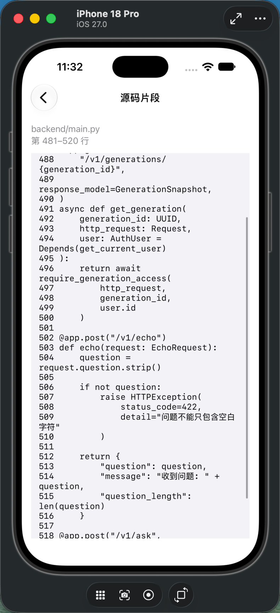
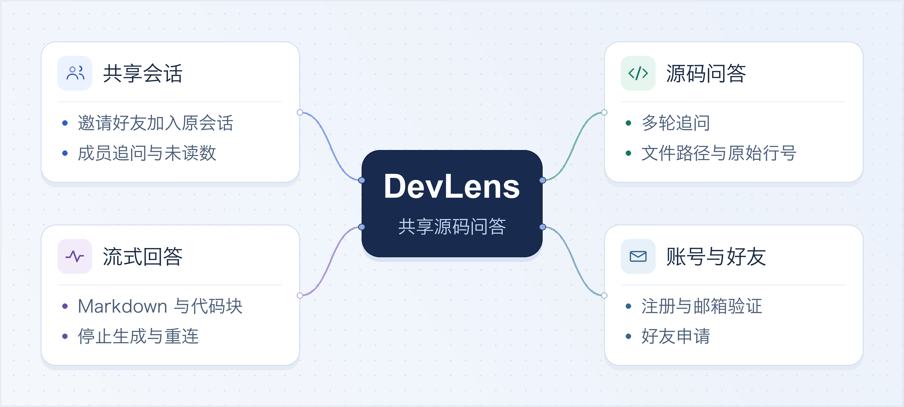
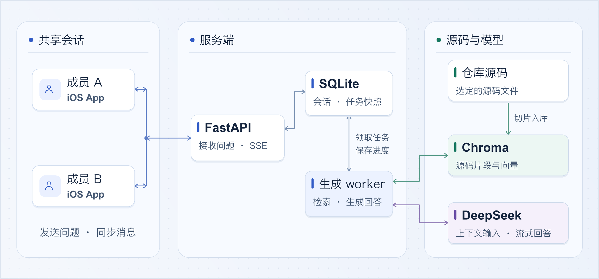

# DevLens

**在同一个 AI 会话里结对读代码。**

DevLens 是一个 iOS 源码问答工具。排查接口时，你可以先让 AI 找相关实现，再点开源码核对。想让队友一起看，就邀请对方加入原会话。队友看到前面的问答和源码片段后，可以直接从自己关心的地方继续问。

[体验示例](#体验示例) · [项目功能](#项目功能) · [工作原理](#工作原理) · [快速开始](#快速开始) · [项目结构](#项目结构)

## 体验示例

一个人先确认空白输入会返回什么状态码，另一个人接着问错误提示。两个人共享同一段讨论，也都能打开前一轮回答的来源。

| 一个人先问 | 打开源码核对 | 队友在原会话追问 |
| :---: | :---: | :---: |
|  |  |  |

1. **把问题问到具体接口。**「`/v1/ask` 收到只含空白字符的 `question` 时，会返回什么状态码？」AI 回答 `422`，给出文件和行号。
2. **点开「查看来源」。** 回答下方可以打开这一轮检索到的多个片段。截图里打开的是 `backend/main.py` 中 `/v1/echo` 的校验片段。[第一轮回答引用的 `/v1/ask` 校验代码](backend/main.py#L523-L529)
3. **让队友顺着上一个问题追问。**「那这个分支返回的错误提示是什么？」这次检索只找到了 `/v1/ask` 的开头，模型在会话里说明了缺失的源码。两个人仍可打开前一轮的来源核对。

[用两个账号体验共享会话](docs/DEVELOPMENT.md#体验共享会话)

## 项目功能

[](docs/images/devlens-features.png)

- **共享会话**。会话所有者可以邀请好友。接受邀请后，好友可以查看已有问答和参考源码，也可以继续提问。App 在前台同步会话变更和未读数。
- **源码问答**。来源页保留当轮提供给模型的具体代码，即使多个片段来自同一个文件，也能分别按原始行号查看。
- **流式回答**。聊天页逐步显示 Markdown 和代码块，支持复制代码或中途停止。离开 App 时，运行中的后端 worker 可以继续生成，重新进入会话就能看到最新进度。

## 工作原理

[](docs/images/devlens-architecture.png)

1. **创建任务。** UIKit 客户端把问题和会话历史提交给 `/v1/generations`。FastAPI 检查会话访问权限，再把任务和消息持久化到 SQLite。同一个请求可以用原 `request_id` 重试。[生成入口](backend/main.py#L661)
2. **检索并生成。** worker 领取任务，用当前问题和最近的历史问题辅助检索。检索结合关键词与向量相似度，用 RRF 合并候选，再用 CrossEncoder 重排。命中的代码片段连同对话上下文交给 DeepSeek，worker 持续保存回答进度。[生成流程](backend/generation_worker.py) · [检索实现](backend/code_retriever.py) · [历史问题如何参与检索](backend/retrieval_service.py)
3. **让成员看见同一份进展。** 聊天页可以订阅生成任务的 SSE 快照，重连后收到最新版本。共享会话通过另一条 SSE 通道通知成员客户端有更新，客户端再从服务端读取消息。[任务快照](backend/main.py#L749) · [会话更新](backend/main.py#L993)

**当前范围。** 默认索引 DevLens 自身的三份源码。检索在本地运行，命中的源码和对话上下文会发送给 DeepSeek。来源页显示当轮给模型的片段，回答中的引用需要人工核对。[索引配置](backend/repo_context.py#L8-L12) · [模型上下文](backend/llm_service.py#L23)

## 快速开始

准备一台 Mac，安装 Xcode 27、iOS 27 模拟器运行时和 Python 3.12，并准备 DeepSeek API Key。检索模型首次运行时会下载到本地。首次注册需要 Mailpit 收取本地验证邮件。

### 1. 安装后端依赖

从仓库根目录执行以下命令。

```bash
cd backend
python3.12 -m venv .venv
source .venv/bin/activate
python -m pip install -r requirements.txt
```

在 `backend/.env` 中设置密钥。该文件已被 Git 忽略。

```dotenv
DEEPSEEK_API_KEY=你的密钥
```

### 2. 建立源码索引并启动服务

以下四条命令均在 `backend/` 下运行。新开终端后，先执行 `source .venv/bin/activate`。

| 顺序 | 命令 | 就绪标志 |
| --- | --- | --- |
| 1. Chroma | `chroma run --path .chroma --host 127.0.0.1 --port 8001` | 保持终端运行 |
| 2. 建索引 | `python build_index.py` | 输出索引片段数量后退出 |
| 3. API | `python -m uvicorn main:app --reload --env-file .env --host 0.0.0.0 --port 8000` | 出现 `Application startup complete` |
| 4. 生成 worker | `python generation_worker.py` | 出现「后台执行器已就绪」 |

建索引的终端可以接着运行 API。Chroma、API 和 worker 各自保持运行。打开 [健康检查](http://127.0.0.1:8000/health)，确认返回 `"status": "ok"`。

### 3. 在模拟器里完成第一次问答

1. 首次注册时，用 Homebrew 安装 Mailpit（`brew install mailpit`），在独立终端运行 `mailpit --listen 127.0.0.1:8025 --smtp 127.0.0.1:1025`。已有验证账号可以直接登录。
2. 用 Xcode 打开 `ios/DevLens/DevLens.xcodeproj`，选择 iPhone 模拟器，按 `⌘R`。
3. 在登录页点「创建账号」，提交后打开 [Mailpit 收件箱](http://127.0.0.1:8025) 复制验证 Token。回到 App 验证邮箱，然后登录。
4. 在「会话」点「新建」，输入[示例问题](#体验示例)。看到回答后点「查看来源」，打开任一个片段可看到文件路径和原始行号。

如果回答一直排队，先检查 worker 是否已就绪。用 iPhone 真机时，按 [真机配置](docs/DEVELOPMENT.md#iphone-真机) 调整 API 监听地址和 App 配置。

## 项目结构

```text
DevLens/
├── ios/DevLens/
│   ├── DevLens.xcodeproj
│   └── DevLens/
│       ├── Views/             # UIKit 聊天、会话、好友与源码页面
│       ├── ViewModels/        # 生成任务、会话事件与账号状态
│       ├── Services/          # API、SSE、Markdown 与认证
│       └── Storage/           # 本地会话缓存与登录凭据
├── backend/
│   ├── main.py                # FastAPI 路由与 SSE
│   ├── conversation_store.py  # 会话、成员、邀请与已读位置
│   ├── generation_store.py    # 持久化生成任务和会话消息
│   ├── generation_worker.py   # 执行任务并保存生成进度
│   ├── build_index.py         # 构建 Chroma 源码索引
│   ├── code_retriever.py      # 混合检索与重排
│   ├── llm_service.py         # 构造上下文并调用 DeepSeek
│   └── tests/
└── docs/
    ├── DEVELOPMENT.md        # 本地开发与接口指南
    └── images/                # Demo 的 iOS 模拟器截图
```

[开发指南](docs/DEVELOPMENT.md)包含双账号演示、真机配置、索引更新、后端接口和测试。服务启动后也可以查看 [FastAPI 接口文档](http://127.0.0.1:8000/docs)。

## 已完成功能

### 聊天与源码阅读

- **浏览流式回答。** 生成时自动跟随最新内容，向上浏览旧消息时暂停跟随，滑回底部附近后恢复。也可以点「回到最新」直接返回。输入区支持键盘避让，拖动或点按消息列表可收起键盘。
- **阅读和复制回答。** AI 回答支持 Markdown 标题、强调、列表、引用和代码块。代码块显示语言并可单独复制，长按消息可以复制整条内容。生成状态和错误提示独立于正文显示。
- **查看参考源码。** 可以从回答打开来源列表，按文件路径和原始行号查看当轮参考的片段。源码详情支持文本选择、复制、动态字体和系统浅色或深色外观。

### 账号与共享会话

- **账号与好友。** 在 App 内完成注册、邮箱验证和登录，也可设置头像。在「我的 → 好友」可按邮箱发起好友申请，也可处理收到的申请。
- **从个人会话开始协作。** 会话所有者可以邀请好友加入。发送前，App 会提示好友接受后可查看历史消息和参考源码。好友可以在「会话 → 会话邀请」接受或拒绝，接受后可接着原来的讨论提问。
- **区分成员与未读消息。** 会话列表分为「个人」和「共享」，聊天里用「我」、成员昵称和「DevLens」区分发言者。App 在前台同步会话和未读数，浏览到最新消息后自动记录已读位置。

### 生成任务与恢复

- **停止和中断处理。** 可以中途停止生成并继续提问。生成停止或异常中断时，界面保留已有回答，并显示对应状态。
- **重新进入时接上进度。** SQLite 保存会话消息、成员关系和生成任务，iOS 按账号缓存会话。离开 App 后，服务端 worker 仍可继续生成，重新打开会话时通过 SSE 获取最新快照。创建请求可复用原 `request_id` 重试。
- **管理多轮上下文。** 问答会携带相关历史，检索也会参考近期问题。历史消息有条数和长度限制，达到限制后可以新建会话继续。

## 当前代码库问答范围

默认索引覆盖 DevLens 仓库里的这三份源码。完整列表定义在 [`SOURCE_FILES`](backend/repo_context.py#L8-L12)。

- [`backend/main.py`](backend/main.py)
- [`ios/DevLens/DevLens/Services/Networking/APIClient.swift`](ios/DevLens/DevLens/Services/Networking/APIClient.swift)
- [`ios/DevLens/DevLens/ViewModels/QuestionViewModel.swift`](ios/DevLens/DevLens/ViewModels/QuestionViewModel.swift)

### 分块与检索

源码按最多 **40 行**切成片段，相邻片段重叠 **8 行**，保留文件路径和原始行号。`intfloat/multilingual-e5-small` 在本地 CPU 生成向量，源码与向量保存在本地 Chroma 的 `backend/.chroma`。向量模型和重排模型在首次使用时下载。[分块实现](backend/repo_context.py#L42) · [建索引脚本](backend/build_index.py)

1. 对单个查询，关键词检索和向量检索各取最多 **6 个候选**。关键词排序按词项重合计数。
2. 用 RRF 合并并去重，最多保留 **12 个候选**，再用 `cross-encoder/mmarco-mMiniLMv2-L12-H384-v1` 重排。
3. 最终最多 **3 个源码片段**与问题和对话上下文一同交给 DeepSeek。多轮问答会额外选取最多两个不同的近期历史问题，合并这些查询的结果后再确定最终片段。

[混合检索](backend/code_retriever.py) · [历史问题如何参与检索](backend/retrieval_service.py)

### 来源与更新索引

「查看来源」显示当轮实际提供给模型的片段。同一文件可以出现多次，每个片段都有自己的行号范围。结果可能漏检或排序不准，回答中的引用需要结合源码核对。检索结果为空时，后端直接返回说明，省去模型调用。[生成与提示词](backend/llm_service.py)

建索引时保留这三份文件的相对路径。修改被索引的源码后，保持 Chroma 运行，先停止 API、worker 和查询程序。在 `backend/` 中激活虚拟环境，运行 `python build_index.py`，再启动 API 和 worker。[更新和验证索引](docs/DEVELOPMENT.md#更新或单独验证索引)
